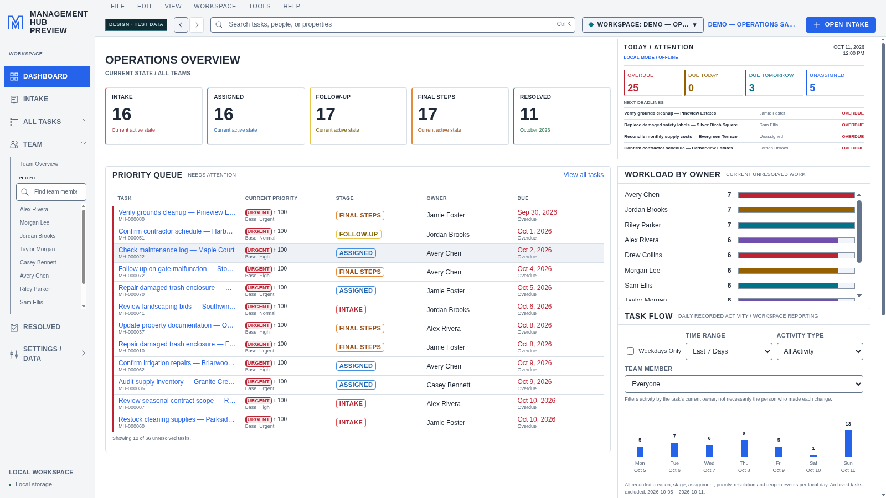
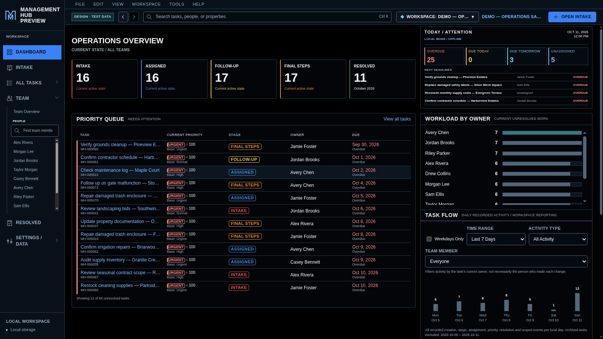
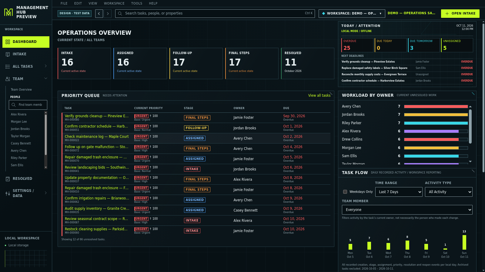
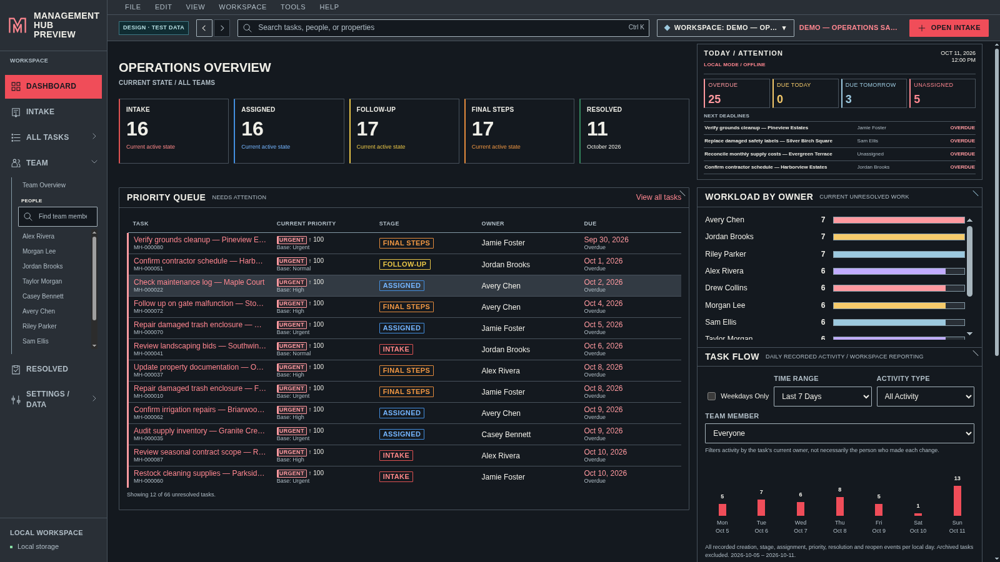
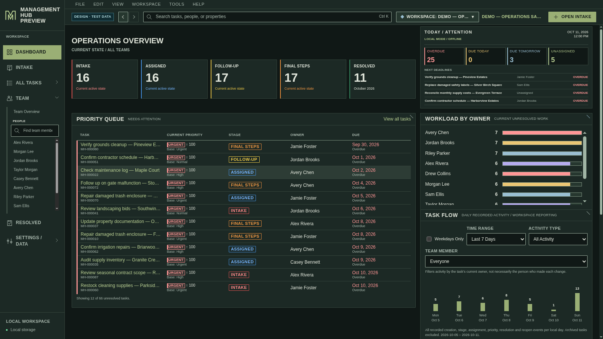
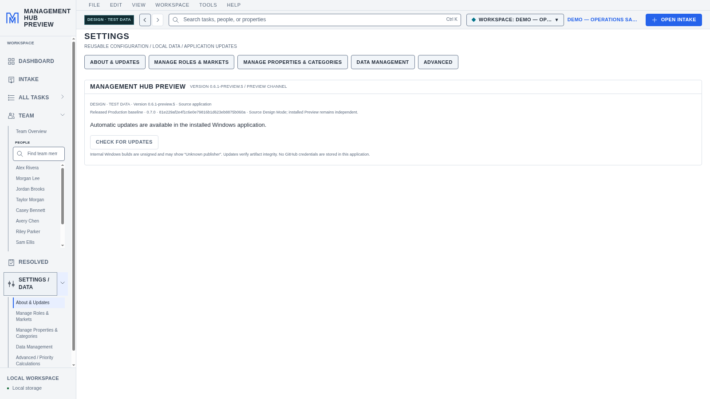

# Management Hub — synchronized Design Mode review

Actual Electron screenshots from fictional disposable data only. Application source remains private. This review branch changes no update feed and publishes no installer.

Released Production: **v0.7.0**, source `81e229af2e4f1c6e0e79816b1d623eb8875b060a`. Design branch: `feature/design-production-0.7.0`, synchronization commit `07b2221`. All eight approved groups are shared; runtime identities and storage stay independent. Installed Preview remains v0.6.1-preview.5.

Final Windows run: https://github.com/Cujo3211/personal-tracker/actions/runs/38336754274 — 918 passing executions including both genuine previous-version updater paths. Design checks: 370 focused tests plus navigation/sidebar checkpoints; all five themes at three sizes. The ZIP includes full-resolution captures and verification reports.

## Default

## Night

## Runner

## Agent

## Ring

## Released source baseline

[Download all screenshots and reports](Management-Hub-Design-0.7.0-Screenshots.zip)
